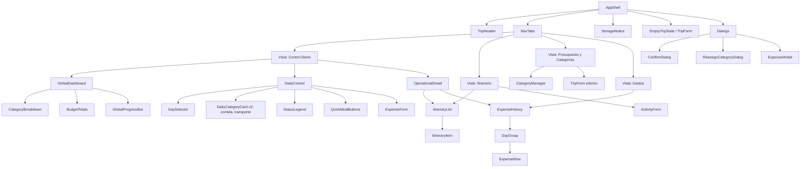
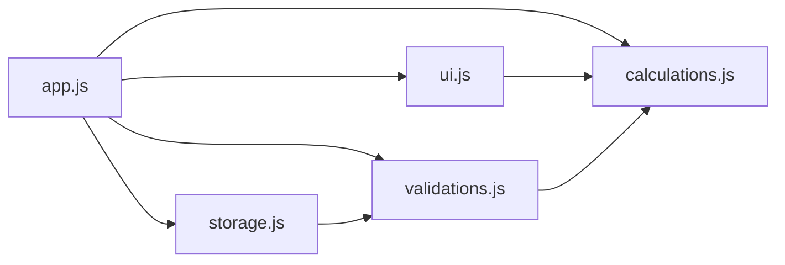
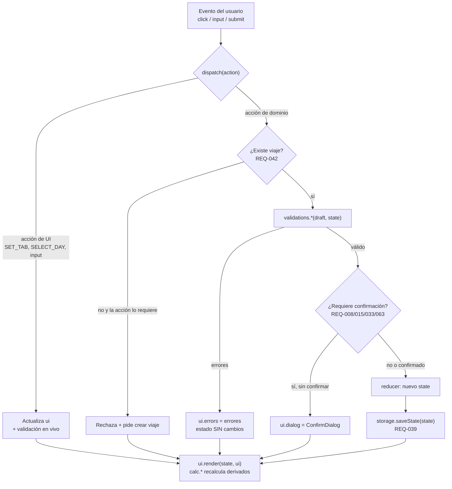
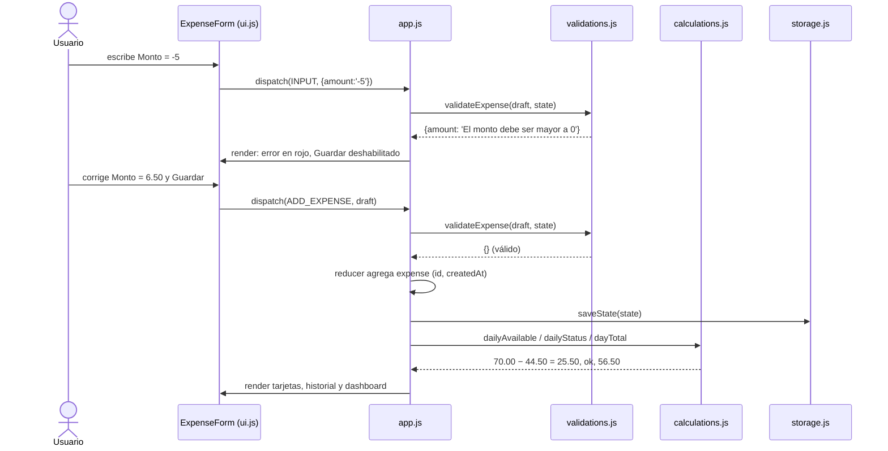
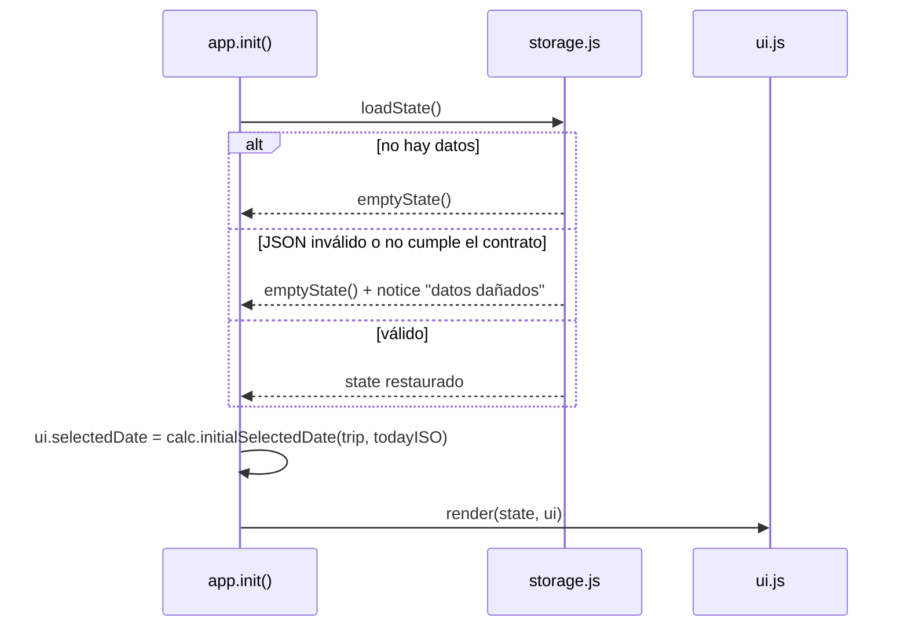
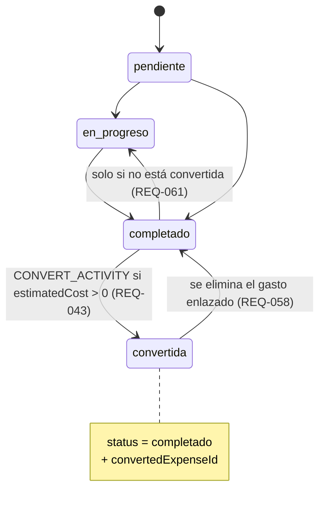

# Documento de Diseño Técnico y Arquitectura — NomadPulse Travel Assistant

> **ENTREGABLE PRINCIPAL (S3L1).** Traduce la especificación EARS ([`requirements.md`](./requirements.md)),
> el contrato de datos ([`data-contract.json`](./data-contract.json)) y el wireframe
> ([`wireframe.md`](./wireframe.md) · [`wireframe.png`](./wireframe.png)) en componentes, módulos, manejo de estado y flujos de datos.
> La memoria semántica que guía los nombres está en [`../CLAUDE.md`](../CLAUDE.md). Es el insumo directo de la implementación (Semana 4).

**Curso:** Programación Intencional con IA Generativa
**Estudiante:** José Fallas — jfallash@ucenfotec.ac.cr
**Aplicación:** Viajero — Asistente Personal de Viaje & Presupuesto
**Versión:** 3 (Octubre 2026) · Especificación v2 · Contrato `schemaVersion: 2`

---

## 1. Visión general, stack y poda arquitectónica

| Aspecto | Decisión |
|---|---|
| Tipo de app | SPA estática de una sola página (`src/index.html`) |
| Stack | HTML + CSS puro escrito a mano + JavaScript vanilla (sin frameworks, librerías, build ni CDN) |
| Estado | **Un objeto de estado en memoria** (`state`) dentro de `app.js` + estado de interfaz (`ui`) no persistido |
| Persistencia | `localStorage`, clave `viajero.state`, estado completo en cada mutación (REQ-039) |
| Red | Ninguna. Se bloquea por diseño con Content-Security-Policy (REQ-038) |
| Ejecución | Abrir `src/index.html` con doble clic (`file://`) **o** publicarla en GitHub Pages (§10) |
| Modelo de viaje | Máximo **un** viaje (REQ-062) |

**Poda de sobreingeniería (descartado a propósito):**

| Propuesta típica de la IA | Por qué se descarta | Alternativa ligera adoptada |
|---|---|---|
| React / Vue / Svelte | Viola "sin frameworks"; exige build | Funciones de render en `ui.js` que crean DOM |
| Redux / Zustand / store reactivo | Un solo usuario, un solo viaje: no hace falta | Un `state` + función `dispatch(action)` en `app.js` |
| Backend, API REST, base de datos | Viola REQ-038 (offline, sin servidor) | `localStorage` |
| IndexedDB / Service Worker / PWA | Más complejidad que valor para este alcance | `localStorage` (los datos caben de sobra) |
| Ajv u otro validador de JSON Schema | Es una dependencia externa | Validador escrito a mano en `storage.js` que replica el contrato (§5.4) |
| ES Modules (`import`/`export`) | Los navegadores los bloquean en `file://` | Scripts clásicos con un espacio de nombres global `window.Viajero` (§5.1) |
| Notificaciones / recordatorio diario | No está en la especificación v2 | Fuera de alcance |

## 2. Memoria semántica: del lenguaje ubicuo al código

Las entidades del dominio (CLAUDE.md §3) tienen un nombre único en el código:

| Entidad (lenguaje ubicuo) | En el contrato | En el código | ¿Persistida? |
|---|---|---|---|
| **Trip** | `trip` | `state.trip` | Sí |
| **Category** | `categories[]` | `state.categories` | Sí |
| **GlobalBudget** | — (derivado) | `calc.globalBudget(state)` → `{ total, spent, committed, available, status }` | No |
| **DailyFoodLimit** | — (derivado) | `calc.dailyLimit(state, 'cat-comida')` | No |
| **DailyTransportLimit** | — (derivado) | `calc.dailyLimit(state, 'cat-transporte')` | No |
| **Expense** | `expenses[]` | `state.expenses` | Sí |
| **ItineraryItem** (actividad) | `itinerary[]` | `state.itinerary` | Sí |
| **DayTotal** | — (derivado) | `calc.dayTotal(state, date)` | No |

**Invariantes del dominio que el diseño hace cumplir** (detalle en CLAUDE.md §5):

1. **Persistencia obligatoria en LocalStorage:** `dispatch` siempre termina en `storage.saveState(state)`.
2. **Validación estricta:** ninguna acción muta el estado si `validations.*` devuelve errores. Se rechazan montos ≤ 0 o no numéricos y campos vacíos.
3. **Límite diario dinámico:** `Disponible Hoy = (Total Comida / Días Totales) − Acumulado del Día`, implementado en `calc.dailyAvailable`. Lo mismo aplica a transporte.

## 3. Reglas de negocio y función responsable

| Regla | Fórmula | Función (`calculations.js`) |
|---|---|---|
| RN-01 | `totalDays = (endDate − startDate) + 1` (inclusivo) | `totalDays(trip)` |
| RN-02 | `dailyLimit = allocated / totalDays` (comida, transporte) | `dailyLimit(state, categoryId)` → `number \| null` |
| RN-03 | `Disponible = dailyLimit − Σ gastos variables de la categoría en la fecha` | `dayAccumulated(state, categoryId, date)`, `dailyAvailable(state, categoryId, date)` |
| RN-04 | `% = acumulado / límite × 100` → `ok` ≤80 · `warning` ≤100 · `exceeded` >100 | `dailyStatus(state, categoryId, date)` |
| RN-05 | Validaciones de borde | `validations.validateExpense/Trip/Category/Activity` |
| RN-06 | `Total = Σ allocated`; `Disponible Global = Total − Σ amount` | `globalBudget(state)` |
| RN-07 | `Total del Día = Σ gastos variables de todas las categorías en la fecha` | `dayTotal(state, date)` |

Hay un ejemplo verificable en el wireframe: comida $560 / 8 días = $70.00; acumulado $44.50 → 63.57 % → se muestra "64 %", estado `ok`.

## 4. Arquitectura de componentes de la interfaz (según el wireframe)

Cada "componente" es una función de render en `ui.js` que recibe `(state, ui)` y devuelve un nodo DOM. Los componentes no mutan el estado: emiten acciones mediante atributos `data-action`, que `app.js` captura por delegación de eventos.



| Componente | Responsabilidad | Lee | Emite (acción) | REQ |
|---|---|---|---|---|
| `AppShell` | Estructura, pestañas activas, montaje de diálogos | `state`, `ui` | `SET_TAB` | — |
| `TripHeader` | Destino, rango ISO y `totalDays`; botones Editar/Eliminar viaje | `trip`, `calc.totalDays` | `OPEN_TRIP_EDIT`, `REQUEST_DELETE_TRIP` | 005, 008, 063 |
| `EmptyTripState` / `TripForm` | Crear o editar el viaje con validación en vivo | `trip`, `ui.errors` | `CREATE_TRIP`, `UPDATE_TRIP` | 001–004, 030, 042, 062 |
| `StorageNotice` | Aviso de estado corrupto o de error al guardar | `ui.notice` | `DISMISS_NOTICE` | 041, 064 |
| `CategoryBreakdown` | `asignado / gastado` y mini-barra por categoría; "Sin presupuesto" | `categories`, `calc.categorySpent` | — | 006, 052 |
| `BudgetTotals` | Total, gastado, comprometido (fijos) y disponible global con estado | `calc.globalBudget` | — | 006, 012–014, 051 |
| `GlobalProgressBar` | Barra `spent / total` | `calc.globalBudget` | — | 006 |
| `DaySelector` | Días 1..N con marca HOY | `calc.tripDates`, `ui.selectedDate` | `SELECT_DAY` | 054 |
| `DailyCategoryCard` | Asignado/Acumulado/Disponible Hoy, barra y estado de color | `calc.dailyLimit/Accumulated/Available/Status` | — | 019–022, 050, 052 |
| `StatusLegend` | Leyenda Verde/Ámbar/Rojo | — | — | 022 |
| `QuickMealButtons` | Un botón por `mealType` con su acumulado; precarga `ExpenseForm` | `calc.mealTotals` | `PREFILL_MEAL` | 029 |
| `ExpenseForm` / `ExpenseModal` | Fecha, Categoría, Tipo de comida (solo comida), Monto, Descripción, Fijo; errores en vivo; Guardar deshabilitado con errores | `ui.draft`, `ui.errors` | `ADD_EXPENSE`, `UPDATE_EXPENSE`, `CONVERT_ACTIVITY` | 010, 025–029, 047, 055–057 |
| `ItineraryList` / `ItineraryItem` | Actividades de la fecha en orden de inserción; estado; botón Convertir solo si `calc.canConvert` | `itinerary`, `ui.selectedDate` | `OPEN_CONVERT`, `SET_ACTIVITY_STATUS`, `DELETE_ACTIVITY` | 034–036, 043–046, 061 |
| `ActivityForm` | Alta/edición manual de actividad | `ui.draft` | `ADD_ACTIVITY`, `UPDATE_ACTIVITY` | 031, 035, 060 |
| `ExpenseHistory` / `DayGroup` / `ExpenseRow` | Gastos agrupados por fecha con Total del Día; grupo "Pre-viaje / Fijos"; ✎ y 🗑 | `calc.groupExpensesByDate`, `calc.dayTotal` | `OPEN_EDIT_EXPENSE`, `REQUEST_DELETE_EXPENSE` | 011, 033, 047, 053, 057 |
| `CategoryManager` | Crear, renombrar, asignar monto, eliminar (oculto para las del sistema) | `categories` | `ADD_CATEGORY`, `UPDATE_CATEGORY`, `REQUEST_DELETE_CATEGORY` | 015–018, 023, 048, 049 |
| `ConfirmDialog` | Confirmaciones genéricas con lista de afectados | `ui.dialog` | `CONFIRM`, `CANCEL` | 008, 009, 033, 063 |
| `ReassignCategoryDialog` | Selección de categoría destino (y `mealType` si el destino es comida) | `ui.dialog` | `DELETE_CATEGORY` | 015, 016 |

## 5. Estructura de módulos y manejo de estado

### 5.1. Archivos y orden de carga

```text
src/
├── index.html          ← punto de entrada; CSP; carga los scripts en este orden ↓
├── css/styles.css      ← CSS puro (variables de color para los estados ok/warning/exceeded)
└── js/
    ├── calculations.js ← Viajero.calc        (funciones puras: derivados RN-01..RN-07, fechas, dinero)
    ├── validations.js  ← Viajero.validate    (funciones puras: errores por campo)
    ├── storage.js      ← Viajero.storage     (loadState, saveState, validateState, emptyState)
    ├── ui.js           ← Viajero.ui          (componentes de render + helper el())
    └── app.js          ← Viajero.app         (state, ui, dispatch, reducers, eventos, arranque)
```

Cada archivo es un script clásico envuelto en una IIFE que registra su API en `window.Viajero`. Así la app funciona con doble clic (`file://`) y también en GitHub Pages.



Regla de dependencias: `calculations.js` no depende de nada, y solo `app.js` toca `state`.

### 5.2. Estado global en memoria vs. LocalStorage

| | `state` (dominio) | `ui` (interfaz) | `localStorage['viajero.state']` |
|---|---|---|---|
| Contenido | `schemaVersion, trip, categories, expenses, itinerary` | `activeTab, selectedDate, draft, errors, dialog, notice` | Copia JSON exacta de `state` |
| Forma | `data-contract.json` | Libre (no se persiste) | `data-contract.json` |
| Quién lo cambia | Solo los reducers de `app.js` vía `dispatch` | `app.js` (acciones de interfaz) | Solo `storage.saveState` |
| Valores derivados | **Nunca** se guardan (se calculan con `calc.*` en cada render) | — | Nunca |
| Ciclo de vida | Se carga al iniciar (REQ-040) | Se inicializa al abrir (`selectedDate` por REQ-054) | Se sobrescribe en cada mutación (REQ-039) |

### 5.3. API de cada módulo

**`calculations.js` (puro, sin DOM):**
`parseISODate(s)`, `toISODate(d)`, `todayISO()`, `isValidISODate(s)`, `tripDates(trip)`, `totalDays(trip)`, `dailyLimit(state, catId)`, `dayAccumulated(state, catId, date)`, `dailyAvailable(state, catId, date)`, `dailyStatus(state, catId, date)`, `mealTotals(state, date)`, `categorySpent(state, catId)`, `globalBudget(state)`, `dayTotal(state, date)`, `groupExpensesByDate(state)`, `itemsOutOfRange(state, newStart, newEnd)`, `canConvert(activity)`, `initialSelectedDate(trip, todayISO)`, `hasMax2Decimals(n)`, `roundMoney(n)`, `formatMoney(n)`, `formatPercent(p)`.

**`validations.js` (puro; devuelve `{ campo: 'mensaje' }`, vacío = válido):**
`validateTrip(draft, state)`, `validateCategory(draft, state)`, `validateCategoryDelete(catId)`, `validateExpense(draft, state)`, `validateActivity(draft, state, original)`, `validateConversion(activity)`.

**`storage.js`:**
`STORAGE_KEY = 'viajero.state'`, `emptyState()`, `validateState(obj)` (réplica manual del contrato), `loadState()` → `{ state, notice }`, `saveState(state)` → `true | error`.

**`app.js`:**
`state`, `ui`, `dispatch(action)`, `reducers` (uno por acción de dominio), `bindEvents(root)`, `init()`.

### 5.4. Ciclo `dispatch` (el único camino para mutar)



**Acciones de dominio:** `CREATE_TRIP`, `UPDATE_TRIP`, `DELETE_TRIP`, `ADD_CATEGORY`, `UPDATE_CATEGORY`, `DELETE_CATEGORY`, `ADD_EXPENSE`, `UPDATE_EXPENSE`, `DELETE_EXPENSE`, `ADD_ACTIVITY`, `UPDATE_ACTIVITY`, `DELETE_ACTIVITY`, `CONVERT_ACTIVITY`.

### 5.5. Secuencias clave

**Registrar un gasto (caso crítico: bloqueo de montos negativos y cálculo diario):**



**Arranque y estado corrupto (REQ-040/041):**



**Ciclo de vida de una actividad y su conversión:**



## 6. Decisiones técnicas que no estaban en `requirements.md`

| # | Decisión | Motivo |
|---|---|---|
| D1 | Scripts clásicos + `window.Viajero` en lugar de ES Modules | Los módulos ES no cargan desde `file://` |
| D2 | Fechas como texto ISO; se calcula con `Date.UTC` y nunca con `new Date('YYYY-MM-DD')` local | En Costa Rica (UTC−6) un parseo ingenuo corre la fecha un día y rompe RN-01 y el "HOY" |
| D3 | "HOY" = fecha **local** del dispositivo (`getFullYear/getMonth/getDate`) | REQ-054 |
| D4 | Sumas en centavos enteros (`Math.round(x*100)`); límites diarios con precisión completa; se redondea solo al mostrar | Evita errores tipo `0.1 + 0.2` y cumple REQ-050 |
| D5 | El DOM se construye con `el(tag, attrs, children)` y `textContent`; nunca `innerHTML` con datos del usuario | Una descripción con `<script>` no debe ejecutarse |
| D6 | `<meta http-equiv="Content-Security-Policy" content="default-src 'self'; connect-src 'none'">` | Hace verificable REQ-038: el navegador bloquea cualquier petición de red |
| D7 | IDs: prefijo + `Date.now().toString(36)` + aleatorio en base 36 (`exp-lx2k9a-4f`) | Cumple los `pattern` del contrato sin librerías |
| D8 | Validador del contrato escrito a mano en `storage.validateState` | No se permite Ajv; replica tipos, `required`, enums y reglas condicionales |
| D9 | Si `saveState` falla (cuota o modo privado), los cambios se mantienen en memoria y se muestra `StorageNotice` | No había REQ: se agregó **REQ-064** |
| D10 | El Monto acepta como máximo 2 decimales | No había REQ: se agregó **REQ-065** |
| D11 | `ui.selectedDate` no se persiste; se recalcula al abrir | REQ-054 lo define al abrir |
| D12 | Re-render completo de la vista activa tras cada `dispatch` (sin DOM virtual) | Basta para decenas o cientos de gastos; es simple de depurar |

## 7. Mapeo explícito de requerimientos → diseño

Columnas: **UI** = componente de §4 · **Lógica** = función o reducer de §5.

| REQ | Resumen | UI | Lógica |
|---|---|---|---|
| 001 | Crear viaje: nombre, destino, fechas | `EmptyTripState`/`TripForm` | `reducers.CREATE_TRIP` |
| 002 | Rechaza nombre/destino/fechas vacías | `TripForm` (error en vivo) | `validate.validateTrip` |
| 003 | Rechaza fin < inicio | `TripForm` | `validate.validateTrip` |
| 004 | Inicio = fin → 1 día | `TripHeader` | `calc.totalDays` |
| 005 | Días inclusivos | `TripHeader`, `DaySelector` | `calc.totalDays`, `calc.tripDates` |
| 006 | Total, gastado y disponible global | `BudgetTotals`, `GlobalProgressBar` | `calc.globalBudget` |
| 007 | *Eliminado* | — | — |
| 008 | Confirmar edición de viaje con datos | `ConfirmDialog` | `dispatch` (paso de confirmación) |
| 009 | Advertir elementos fuera de rango sin borrar | `ConfirmDialog` (lista) | `calc.itemsOutOfRange` |
| 010 | Marcar gasto fijo | `ExpenseForm` (casilla) | `expense.isFixed` |
| 011 | Fijo fuera de acumulados diarios / Total del Día | `DailyCategoryCard`, `DayGroup` | `calc.dayAccumulated`, `calc.dayTotal` (filtran `isFixed`) |
| 012 | Mostrar monto comprometido | `BudgetTotals` | `calc.globalBudget().committed` |
| 013 | Recalcular disponible con fijos | `BudgetTotals` | ciclo `dispatch` → render |
| 014 | Alerta: fijos consumen todo | `BudgetTotals` | `globalBudget().status = 'committed'` |
| 015 | Confirmar eliminar categoría con elementos | `CategoryManager` → `ReassignCategoryDialog` | `dispatch` (confirmación) |
| 016 | Reasignar a categoría destino | `ReassignCategoryDialog` | `reducers.DELETE_CATEGORY(id, targetId)` |
| 017 | Eliminar categoría vacía sin confirmar | `CategoryManager` | `reducers.DELETE_CATEGORY` |
| 018 | Nombre vacío o duplicado | `CategoryManager` | `validate.validateCategory` |
| 019 | Límite diario comida/transporte | `DailyCategoryCard` | `calc.dailyLimit` |
| 020 | Disponible Hoy | `DailyCategoryCard` | `calc.dailyAvailable` |
| 021 | Alerta roja sin bloquear | `DailyCategoryCard` | `validateExpense` **no** consulta límites |
| 022 | Estados ok/warning/exceeded | `DailyCategoryCard`, `StatusLegend` | `calc.dailyStatus` |
| 023 | Asignado ≤ 0 rechazado | `CategoryManager` | `validate.validateCategory` |
| 024 | *Eliminado* | — | — |
| 025 | Monto ≤ 0 / fecha inválida | `ExpenseForm` | `validate.validateExpense`, `calc.isValidISODate` |
| 026 | Descripción vacía | `ExpenseForm` | `validate.validateExpense` |
| 027 | Gasto variable fuera de rango (también al editar uno que quedó fuera) | `ExpenseForm` | `validate.validateExpense` |
| 028 | Monto no numérico | `ExpenseForm` | `validate.validateExpense` |
| 029 | `mealType` obligatorio en comida | `ExpenseForm`, `QuickMealButtons` | `validate.validateExpense` |
| 030 | Fechas del viaje en ISO | `TripForm` | `validate.validateTrip` |
| 031 | Actividad sin título o fuera de rango (también al editar o cambiar estado de una que quedó fuera) | `ActivityForm`, `ItineraryItem` | `validate.validateActivity` |
| 032 | Recalcular al cambiar fechas o asignados | todas las vistas | `dispatch` → render (los derivados nunca se guardan) |
| 033 | Eliminar gasto con confirmación y recalcular | `ExpenseRow` 🗑 → `ConfirmDialog` | `reducers.DELETE_EXPENSE` |
| 034 | No generar itinerarios | `ItineraryList` (solo `ActivityForm`) | no existe ninguna función generadora |
| 035 | Actividades ingresadas por el usuario | `ActivityForm` | `reducers.ADD_ACTIVITY` |
| 036 | No reordenar ni modificar actividades | `ItineraryList` (orden de inserción) | los reducers solo tocan el `id` objetivo |
| 037 | Sin borrados colaterales | — | reducers con alcance mínimo; cascada solo en `DELETE_TRIP` |
| 038 | Sin red | `index.html` (CSP) | no hay `fetch`/XHR (D6) |
| 039 | Persistir en cada mutación | — | `storage.saveState` al final de `dispatch` |
| 040 | Restaurar al iniciar | — | `storage.loadState` en `app.init` |
| 041 | Estado corrupto → vacío + aviso | `StorageNotice` | `storage.validateState`, `storage.emptyState` |
| 042 | Sin viaje → rechazar y pedir crear | `EmptyTripState` | guarda `requireTrip` en `dispatch` |
| 043 | Convertir actividad completada | `ItineraryItem` → `ExpenseModal` precargado | `reducers.CONVERT_ACTIVITY` |
| 044 | Enlace bidireccional | `ItineraryItem` ("✓ Convertida") | `CONVERT_ACTIVITY` guarda ambos ids |
| 045 | Impedir conversión duplicada | mensaje en `ItineraryItem` | `validate.validateConversion` |
| 046 | Ocultar botón si no aplica | `ItineraryItem` | `calc.canConvert` |
| 047 | Fijos exentos del rango | `ExpenseForm`, `DayGroup` "Pre-viaje" | `validate.validateExpense`, `calc.groupExpensesByDate` |
| 048 | Comida/transporte no eliminables | `CategoryManager` (sin botón) | `validate.validateCategoryDelete` |
| 049 | Categorías nuevas `tracking: total` | `CategoryManager` | `reducers.ADD_CATEGORY` |
| 050 | Redondeo de montos y porcentajes | todos los montos | `calc.roundMoney`, `formatMoney`, `formatPercent` |
| 051 | Sobregiro global en rojo | `BudgetTotals` | `globalBudget().status = 'exceeded'` |
| 052 | Categoría diaria sin presupuesto | `DailyCategoryCard`, `CategoryBreakdown` | `calc.dailyLimit` → `null` |
| 053 | Total del Día | `DayGroup` | `calc.dayTotal` |
| 054 | Día seleccionado al abrir | `DaySelector` | `calc.initialSelectedDate` |
| 055 | Categoría obligatoria | `ExpenseForm` | `validate.validateExpense` |
| 056 | Ocultar/no guardar `mealType` fuera de comida | `ExpenseForm` | `reducers.ADD/UPDATE_EXPENSE` eliminan `mealType` |
| 057 | Editar gasto y recalcular fecha/categoría vieja y nueva | `ExpenseRow` ✎ → `ExpenseModal` | `reducers.UPDATE_EXPENSE` |
| 058 | Eliminar gasto enlazado libera la actividad | — | `reducers.DELETE_EXPENSE` |
| 059 | Eliminar actividad conserva el gasto | `ConfirmDialog` (aviso) | `reducers.DELETE_ACTIVITY` |
| 060 | Editar costo de actividad convertida no cambia el gasto | `ActivityForm` | `reducers.UPDATE_ACTIVITY` no toca `expenses` |
| 061 | Actividad convertida no sale de `completado` | `ItineraryItem` | `validate.validateActivity` |
| 062 | Máximo un viaje | `EmptyTripState` | `reducers.CREATE_TRIP` (guarda) |
| 063 | Eliminar viaje con confirmación | `TripHeader` → `ConfirmDialog` | `reducers.DELETE_TRIP` |
| 064 | Fallo al guardar: datos en memoria + aviso + reintento | `StorageNotice` | `storage.saveState` devuelve error; `dispatch` reintenta en la siguiente mutación |
| 065 | Monto con máximo 2 decimales | `ExpenseForm`, `CategoryManager`, `ActivityForm` | `validate.validateExpense/Category/Activity` (`calc.hasMax2Decimals`) |

**Cobertura:** 63 de 63 requerimientos vigentes tienen componente y/o función asignados.

## 8. Diseño visual (CSS)

- Variables en `:root`: `--ok` (verde), `--warning` (ámbar), `--exceeded` (rojo), `--fixed` (violeta) y `--muted`.
- La clase de estado (`is-ok`, `is-warning`, `is-exceeded`) se aplica a la tarjeta y a la barra. El color **siempre** va con texto ("En orden", "Precaución", "Excedido"), no solo con color.
- Layout: Dashboard → Control Diario → Detalle Operativo (dos columnas en escritorio; una columna con `@media (max-width: 720px)`).

## 9. Plan de implementación (Semana 4)

> Resumen. El plan detallado y verificable, con 32 tareas, criterios de aceptación, dataset oficial y pruebas de regresión, está en [`../tasks.md`](../tasks.md).

| Paso | Entregable | REQ que cierra | Verificación manual |
|---|---|---|---|
| 1 | `index.html` + CSP + `styles.css` base + carga de scripts | 038 | La consola no muestra errores; DevTools → Network vacío |
| 2 | `calculations.js` | 004–006, 011, 019–022, 050–054 | En consola: `Viajero.calc.totalDays({startDate:'2026-10-10',endDate:'2026-10-17'}) === 8` |
| 3 | `validations.js` | 002, 003, 018, 023, 025–031, 047, 055, 061, 065 | Casos de la retrospectiva: `-5`, `'abc'`, `'  '`, `2026-02-30` |
| 4 | `storage.js` | 039–041, 064 | Pegar JSON roto en `localStorage` y recargar → aviso + estado vacío |
| 5 | `app.js` (`dispatch`, reducers) | 001, 008–010, 015–017, 033, 042–049, 056–063 | Crear viaje, gastos y actividades; recargar y comprobar que persisten |
| 6 | `ui.js` por vista: Control Diario → Itinerario → Presupuesto → Gastos | resto | Reproducir los datos del wireframe: $70.00 / $44.50 / 64 % / Total del Día $56.50 |

## 10. Puesta en producción ("app viva")

1. Implementar en `src/` según §9.
2. Agregar un `index.html` en la raíz que redirija a `src/` (o mover el contenido de `src/` a la raíz, o a `docs/` si se prefiere).
3. GitHub → *Settings → Pages* → *Deploy from a branch* → `main` / `(root)`.
4. URL resultante: `https://jfallash12.github.io/ProgramacionIntensionadaconIA/`.

GitHub Pages solo **sirve** los archivos estáticos. Los datos siguen en el `localStorage` de cada navegador y nunca salen del dispositivo, así que se mantiene REQ-038.

## Anexo A. Insumos del dominio (S1L2 / S2L2)

### A.1. Entrevista al Cliente

| # | Pregunta | Respuesta del Cliente | Impacto |
|---|---|---|---|
| Q1 | ¿Cómo se distribuye el presupuesto total? | Presupuesto global dividido en categorías: Hospedaje, Tiquetes/Transporte, Actividades/Tours, Compras, Imprevistos y Comida | Colección `categories`; total = suma |
| Q2 | ¿La comida es una bolsa fija o tiene tratamiento diario? | Diario dinámico: **comida y transporte** se dividen entre los días del viaje | `dailyLimit = allocated / totalDays` |
| Q3 | ¿Qué pasa si se excede el límite del día? | No se bloquea; alerta visual explícita (rojo, sobregiro) | Estado `exceeded` |
| Q4 | ¿Cómo persiste la información con conectividad intermitente? | Todo en LocalStorage, sin servidor | `storage.js` |
| Q5 | ¿Reglas de validación del gasto? | Sin montos ≤ 0, sin fechas inválidas, categoría obligatoria; comidas por ocasión | `validations.js`, `mealType` |
| Q6 | ¿Cómo se vincula itinerario y gastos? | Actividad completada con costo estimado → gasto en un clic | `CONVERT_ACTIVITY` |

### A.2. Clarificaciones de la especificación v2

| # | Tema | Decisión | REQ |
|---|---|---|---|
| C1 | Cálculo de días | Inclusivo (10→17 oct = 8 días) | 005 |
| C2 | Categorías | Personalizables; comida y transporte protegidas | 015–018, 048, 049 |
| C3 | Presupuesto global | Suma de las categorías | 006 |
| C4 | Gastos fijos | Exentos del rango de fechas | 047 |
| C5 | Conversión | Solo actividades completadas | 043, 046, 061 |
| C6 | Viajes / cierre del día | Un solo viaje; Total del Día | 053, 062 |
| C7 | Elementos fuera de rango tras cambiar fechas | Se pueden eliminar; para editarlos primero hay que moverlos dentro del viaje | 009, 027, 031 |

### A.3. Modelo de datos (resumen del contrato)

```text
TravelAssistantState
├── schemaVersion  2
├── trip        null | { id, name, destination, startDate, endDate }
├── categories  [ { id, name, allocated?, tracking: daily|total, system } ]
├── expenses    [ { id, categoryId, amount, description, date, time?,
│                   mealType?, isFixed, linkedActivityId?, createdAt } ]
└── itinerary   [ { id, date, time, title, location?, categoryId, notes?,
                    estimatedCost?, status, convertedExpenseId? } ]
```
