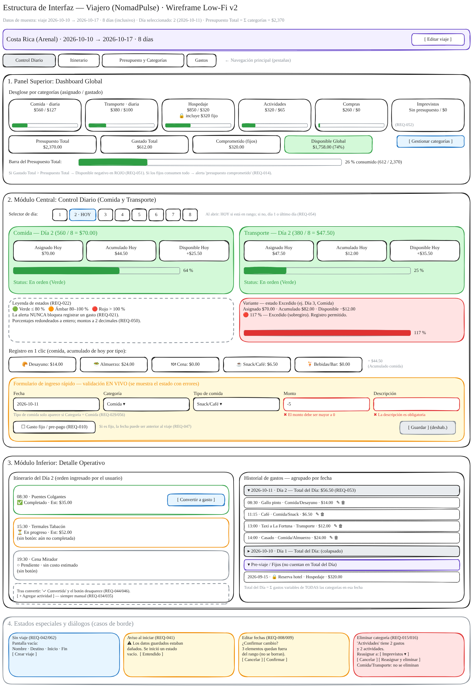

# Boceto de la UI (Wireframe) — Layout por Componentes

**Aplicación:** Viajero — Asistente Personal de Viaje & Presupuesto (NomadPulse Travel Assistant)
**Laboratorio S1L2:** Entrevista, Diseño de Dominio y Wireframing (actualizado a la especificación v2)

> Versión gráfica editable: [`wireframe.excalidraw`](./wireframe.excalidraw) (abrir en excalidraw.com → *Open*).
> Datos de muestra: viaje 2026-10-10 → 2026-10-17 (**8 días**, cálculo inclusivo), día seleccionado: Día 2 (2026-10-11). Presupuesto Total = Σ categorías = $2,370.



## 1. Layout general

```text
+----------------------------------------------------------------------------------+
| ENCABEZADO: Costa Rica (Arenal) · 2026-10-10 → 2026-10-17 · 8 días [Editar viaje] |
| NAVEGACIÓN: [Control Diario] [Itinerario] [Presupuesto y Categorías] [Gastos]    |
+----------------------------------------------------------------------------------+
| 1. DASHBOARD GLOBAL                                                              |
|  Comida·diaria  Transporte·diaria  Hospedaje       Actividades Compras Imprevist.|
|  $560/$127      $380/$100          $850/$320 🔒fijo $320/$65    $260/$0 Sin presup.|
|  [██──]          [██──]            [████─]          [██──]      [─────]  (REQ-052)|
|  Presupuesto Total $2,370 | Gastado $612 | Comprometido (fijos) $320 |           |
|  Disponible Global $1,758 (74%)                     [Gestionar categorías]       |
|  Barra total: [██████──────────────] 26 % consumido                              |
+----------------------------------------------------------------------------------+
| 2. CONTROL DIARIO (COMIDA Y TRANSPORTE)                                          |
|  Selector: [1] [2·HOY] [3] [4] [5] [6] [7] [8]                                   |
|  +-- Comida · Día 2 (560/8 = $70.00) --+  +-- Transporte · Día 2 (380/8=$47.50)-+ |
|  | Asignado $70.00 | Acum. $44.50 |    |  | Asignado $47.50 | Acum. $12.00 |   | |
|  | Disponible +$25.50  [██████──] 64 % |  | Disponible +$35.50 [██────] 25 %   | |
|  | Status: En orden (Verde)            |  | Status: En orden (Verde)           | |
|  +-------------------------------------+  +------------------------------------+ |
|  Leyenda: Verde ≤80 % · Ámbar 80–100 % · Rojo >100 % (nunca bloquea)            |
|  Variante Excedido (Día 3, Comida): Acum. $82.00 · Disp. −$12.00 · 117 % ROJO    |
|  Registro en 1 clic: [Desayuno $14] [Almuerzo $24] [Cena $0] [Snack $6.50]       |
|                      [Bebidas/Bar $0]                                            |
|  FORMULARIO: Fecha | Categoría | Tipo de comida* | Monto | Descripción           |
|              [☐ Gasto fijo / pre-pago]                            [Guardar]      |
|              ✖ El monto debe ser mayor a 0   ✖ La descripción es obligatoria     |
+----------------------------------------------------------------------------------+
| 3. DETALLE OPERATIVO                                                             |
| +-- Itinerario Día 2 ------------------+ +-- Historial (agrupado por fecha) ----+ |
| | 08:30 Puentes Colgantes ✅ Est $35   | | ▾ 2026-10-11 · Día 2 — Total $56.50  | |
| |        [Convertir a gasto]           | |   08:30 Gallo pinto · Comida  $14.00 | |
| | 15:30 Termales ⏳ En progreso $52    | |   11:15 Café · Comida         $6.50  | |
| |        (sin botón: no completada)    | |   13:00 Taxi · Transporte     $12.00 | |
| | 19:30 Cena Mirador ○ sin costo       | |   14:00 Casado · Comida       $24.00 | |
| | [+ Agregar actividad]                | | ▸ 2026-10-10 · Día 1 (colapsado)     | |
| +--------------------------------------+ | ▾ Pre-viaje / Fijos                  | |
|                                          |   2026-09-15 🔒 Reserva hotel $320   | |
|                                          +--------------------------------------+ |
+----------------------------------------------------------------------------------+
| 4. ESTADOS ESPECIALES: Sin viaje [Crear viaje] · Aviso datos corruptos ·          |
|    Confirmar edición de fechas · Eliminar categoría con reasignación             |
+----------------------------------------------------------------------------------+
```

## 2. Descripción por componentes y comportamiento guiado por intención

**Encabezado y navegación**
- Muestra destino, rango de fechas ISO y `totalDays` inclusivo (RN-01). **[Editar viaje]** dispara la confirmación de REQ-008/009.
- Pestañas: Control Diario, Itinerario, Presupuesto y Categorías, Gastos. No hay módulos fuera de las reglas de negocio.

**1. Dashboard Global**
- Desglose `asignado / gastado` por cada categoría del usuario, con mini-barra. Las categorías diarias (comida, transporte) se marcan como "diaria".
- Una categoría sin monto asignado muestra "Sin presupuesto" (REQ-052).
- Totales: Presupuesto Total = Σ asignados = $2,370 (RN-06); Gastado Total = $612 (incluye el fijo de $320); Comprometido (fijos) = $320 (REQ-012); Disponible Global = $1,758 (74 %).
- Barra del presupuesto total: 612 / 2,370 = 26 %. Si el gastado supera el total → disponible negativo en rojo (REQ-051).
- **[Gestionar categorías]**: crear, renombrar y eliminar con reasignación (REQ-015..018, REQ-048/049).

**2. Control Diario (Comida y Transporte)**
- **Selector de día:** al abrir selecciona HOY; si hoy está fuera del viaje, el día 1 o el último (REQ-054).
- **Tarjeta Hero por categoría diaria** (RN-02/RN-03/RN-04), con los términos de la guía: **Asignado Hoy / Acumulado Hoy / Disponible Hoy**.
  - Comida: 560 / 8 = $70.00; acumulado $44.50 → **64 %** (63.57 % redondeado, REQ-050); disponible +$25.50.
  - Transporte: 380 / 8 = $47.50; acumulado $12.00 → 25 %; disponible +$35.50.
- **Leyenda y variante Excedido:** ejemplo del Día 3 con $82.00 de comida → 117 %, disponible −$12.00, en rojo. El registro **nunca se bloquea** (REQ-021).
- **Registro en 1 clic (comida):** un botón por tipo de comida con su acumulado de hoy: 14 + 24 + 0 + 6.50 + 0 = $44.50.
- **Formulario de ingreso rápido** (obligatorio del lab): **Fecha, Monto, Descripción**, más Categoría (REQ-055) y Tipo de comida solo si la categoría es Comida (REQ-029/056), y la casilla *Gasto fijo* (REQ-010). El wireframe muestra el **estado con errores en vivo**: monto −5 y descripción vacía, con el botón Guardar deshabilitado.

**3. Detalle Operativo**
- **Itinerario del día:** actividades en el orden ingresado por el usuario (REQ-036), con estado `completado` / `en_progreso` / `pendiente`. **[Convertir a gasto]** aparece **solo** en actividades completadas, con costo estimado y no convertidas (REQ-043/046). Tras convertir se muestra "✓ Convertida" (REQ-044).
- **Historial agrupado por fecha:** cada grupo muestra el **Total del Día** = Σ gastos variables de todas las categorías (REQ-053): 14 + 6.50 + 12 + 24 = $56.50. Cada gasto tiene acciones editar ✎ (REQ-057) y eliminar 🗑 (REQ-033). Los gastos fijos van en el grupo "Pre-viaje / Fijos" y no suman al Total del Día (REQ-011, REQ-047).

**4. Estados especiales y diálogos**
- Sin viaje → pantalla vacía con el formulario de creación (REQ-001, REQ-042, REQ-062).
- Aviso de datos guardados corruptos (REQ-041).
- Confirmación al editar fechas, con la lista de elementos fuera de rango, sin borrar nada (REQ-008/009).
- Eliminación de categoría con reasignación obligatoria; comida y transporte no se pueden eliminar (REQ-015/016/048).

**Persistencia (Q4)**
- Todo el estado (`schemaVersion`, `trip`, `categories`, `expenses`, `itinerary`) se guarda en LocalStorage en cada mutación y se restaura al iniciar (REQ-039/040). Sin servidores ni internet (REQ-038).
